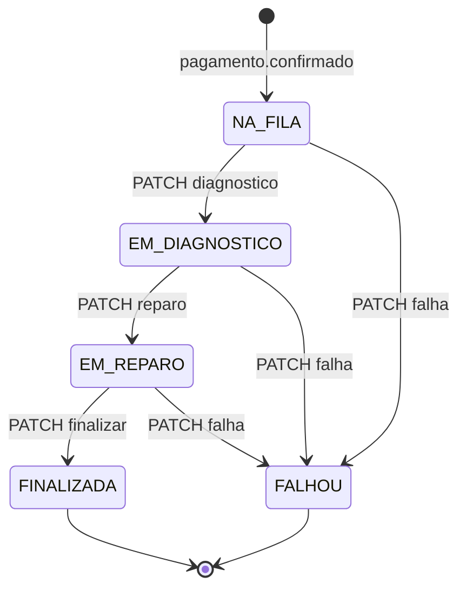

# Contratos de eventos — Execution Service

O Execution é o "chão de fábrica" da saga: fila de trabalho dos mecânicos, diagnóstico e reparo. A infraestrutura e as garantias da mensageria são as mesmas de todos os serviços e estão descritas em `TechChallengerFiap-Application/docs/eventos.md`. No MongoDB, o outbox e o `processed_events` são collections gravadas na mesma transação de sessão da execução.

| Item | Valor |
|---|---|
| Exchange | `oficina.events` (topic). A routing key é o `type` |
| Fila do Execution | `execution-service.events` (+ `.retry` com TTL e `.dlq`) |
| `source` dos eventos publicados | `execution-service` |
| `correlationId` | o `osId` |

## Eventos consumidos

| Evento | De | O que o Execution faz |
|---|---|---|
| `pagamento.confirmado` | Billing | Cria a execução **NA_FILA** com os `servicos` e `pecas` do payload, prioridade 3 (ou `payload.prioridade`) e a primeira entrada do timeline. Publica `execucao.status_atualizado` (`NA_FILA`). |

## Eventos publicados

### `execucao.status_atualizado`
Publicado ao entrar na fila e a cada etapa. O OS Service mapeia `EM_DIAGNOSTICO` para "Em diagnóstico" e `EM_REPARO` para "Em execução". `NA_FILA` não altera a OS.
```json
{ "osId": 42, "execucaoId": "670d2c4f9b1e8a0012345678", "status": "EM_DIAGNOSTICO", "statusAnterior": "NA_FILA", "tecnico": "Ana" }
```

### `execucao.finalizada`
`PATCH /execucoes/:id/finalizar`. A OS vai para "Finalizada".
```json
{ "osId": 42, "execucaoId": "670d...", "tecnico": "Ana", "tempoTrabalhoMinutos": 90,
  "tempoPorEtapaMinutos": { "NA_FILA": 10, "EM_DIAGNOSTICO": 30, "EM_REPARO": 60 } }
```

### `execucao.falhou` (dispara compensações)
`PATCH /execucoes/:id/falha` (motivo obrigatório). O Billing estorna o pagamento, e o OS Service cancela a OS e devolve o estoque.
```json
{ "osId": 42, "execucaoId": "670d...", "statusAnterior": "EM_DIAGNOSTICO", "motivo": "Peça indisponível no fornecedor", "tecnico": "Ana" }
```

## Estados da execução



As mudanças de etapa usam controle de concorrência otimista (`findOneAndUpdate` filtrando pelo status atual). Duas requisições simultâneas para a mesma etapa resultam em uma aplicada e outra com 409.

## Documento da execução (collection `execucoes`)

```json
{
  "osId": 42, "orcamentoId": 7, "pagamentoId": 3, "prioridade": 3, "status": "EM_REPARO", "tecnico": "Ana",
  "servicos": [{ "servicoId": 1, "nome": "Troca de óleo", "quantidade": 1 }],
  "pecas": [{ "pecaId": 4, "nome": "Filtro", "quantidade": 2 }],
  "timeline": [
    { "status": "NA_FILA", "em": "2026-10-14T08:00:00Z", "por": "sistema", "observacao": "Pagamento confirmado" },
    { "status": "EM_DIAGNOSTICO", "em": "2026-10-14T08:10:00Z", "por": "Ana" },
    { "status": "EM_REPARO", "em": "2026-10-14T08:40:00Z", "por": "Ana" }
  ]
}
```

O timeline embutido é o motivo de usar um banco de documentos aqui. Cada execução é lida e gravada inteira, e as métricas (`GET /execucoes/metricas`: tempo médio por etapa e por serviço) saem direto dele.
